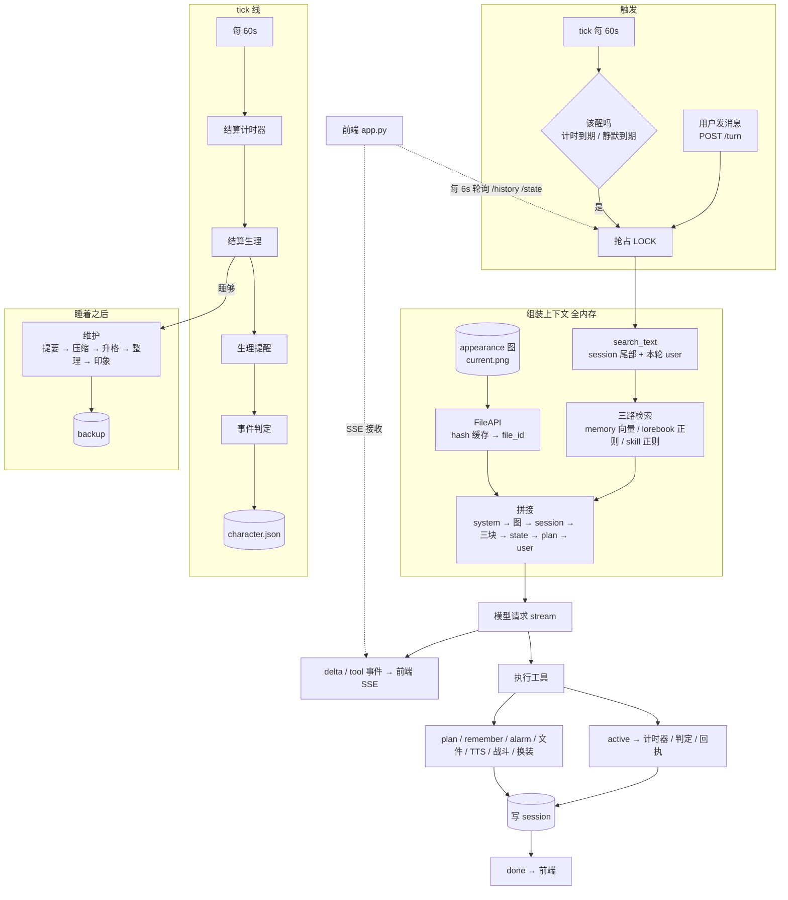

# 系统执行图与子系统清单

整个系统两条线：**模型调用线**（她做了什么）和 **tick 线**（世界过了多久）。
其余都是挂在这两条线上的小系统。

---

## 一、总览



---

## 二、两条线的实现位置

| 线 | 入口 | 主要函数 |
|---|---|---|
| 模型调用 | `POST /turn`、`idle_tick()` | `core.context_assemble` → `modelio.send/stream` → `tools.execute_tool_call` |
| tick | `idle_loop()`，60s 一次 | `timers.settle` → `timers.advance` → `reminders.check` → `events.check` → `should_wake` |

---

## 三、子系统清单

### A. 组装与请求

| 系统 | 触发 | 读写 | 文件 |
|---|---|---|---|
| 静态段拼接 | 每次组装 | 读 md / json | `ConsciousnessRealm/*.md`、`plan/agenda.json` |
| search_text | 每次组装 | 内存 | — |
| 向量检索 | 每次组装 | 读向量库 | `ConsciousnessRealm/embedding/*` |
| lorebook / skill 匹配 | 每次组装 | 内存 | `lorebook/lorebook.json`、`skill/skill.json` |
| **外观图** | 每次组装 | 读图 | `state/media/self/appearance/current.png` |
| **FileAPI 上传** | 图片第一次出现 | 读写缓存 | `state/file/hash.json`（30 天过期，余量 <1h 重传，单文件 64MB） |
| 流式解析 | 每轮 | 内存 | — |
| 工具回执组装 | 每次工具 | 写 session | `state/session/session.jsonl` |

### B. 工具（她做的事）

| 工具 | 落到哪 | 备注 |
|---|---|---|
| `active` | `body.commit` → 计时器 | slot / minutes / force / scene / line |
| `alarm` | `timers.json` | 覆盖式，只留一个 |
| `fight` | `body` / `combat.py` | 回合制 |
| `plan` | `plan/agenda.json` + `archive/` | 目标与步骤 |
| `remember` | 记忆块候选 | 等 dream 升格 |
| `readFiles` / `listFiles` / `writeFile` | 文件系统 | 走 `system/guard.py` |
| `speak` | TTS 服务 | 返回音频路径 |
| `tavily*` | 外网 | 搜索/抓取/爬取 |
| **`appearance`**（本机） | 图 + `outfit.json` | 读底图、写 `current.png`、存档到 `state/media/self/` |

### C. 状态与落盘

| 系统 | 写什么 | 文件 |
|---|---|---|
| 角色状态 | 位置、生理、情绪、关系 | `state/realTime/character.json` |
| 计时器 | 槽位、剩余、奖励 | `state/realTime/timers.json` |
| 待办回执 | 到期提示 | `state/realTime/pending.json` |
| 提醒 | 生理阈值 | `state/realTime/reminders.json` |
| 事件 | 槽位、已触发 | `state/realTime/events.json` |
| 维护标记 | due / doneFor | `state/realTime/maintenance.json` |
| **换装记录** | 当前穿着 + 时间 | `state/media/self/appearance/outfit.json` |
| 原子写 | 所有 JSON | `engine/fsio.py`（pid+线程+uuid 临时文件） |

### D. tick 与事件

| 系统 | 频率 | 说明 |
|---|---|---|
| 计时器结算 | 60s | 到期动作落账（位置、数值） |
| 生理推进 | 60s | 五指标 + 耦合系数 |
| 生理提醒 | 60s | 阈值必触发 |
| 事件判定 | 现：按池按槽位<br/>重构后：整点 | 命中写 state |
| 静默唤醒 | 60s 检查 | 醒着且静默超时才醒 |

### E. 睡着之后

| 系统 | 顺序 | 说明 |
|---|---|---|
| 维护 | 睡够 → 后台线程 | 失败不写 doneFor，醒来“头昏眼花” |
| 提要 | 1 | 模型写摘要 |
| 压缩 | 2 | 归档旧轮次 → 切片入库 |
| 升格 | 3 | 切片→块→MEMORY→PERSONA |
| 整理 | 4 | 去重合并（`dream.tidy`），越界不写 |
| 印象 | 5 | U 消息 > retainedTrun 才做 |
| 备份 | 启动 / 维护后 | `state/backup/日期/时间/`，保留 14 天 |

### F. 观测

| 系统 | 内容 | 文件 |
|---|---|---|
| runlog | 回合、流、工具、崩溃 | `state/logs/YYYY-MM-DD.jsonl` |
| trace | 逐事件（含 sleep.*） | `state/tmp/trace-*.jsonl` |
| usage | token / 缓存命中 | `state/usage/*.jsonl` |

### G. 前端

| 页面 | 读什么 | 写什么 |
|---|---|---|
| 对话 | `/history` 轮询、`/turn` SSE | — |
| 配置 | `/config` | `POST /config` |
| 识域 | `/realm`、`/realm/<名>` | `PUT /realm/<名>` |
| 技能 | `/skill` | `POST /skill` |

---

## 四、谁写谁读（避免两个地方写同一份）

| 数据 | 唯一写入者 | 读取者 |
|---|---|---|
| 生理数值 | tick 线 | 组装、body |
| 计时器 | 工具（创建）/ tick（结算） | 组装、body |
| 事件 | tick 线 | 组装 |
| state 文本 | 组装时现算 | 模型 |
| session | 模型线 | 组装、压缩、印象 |
| MEMORY / PERSONA | dream | 组装 |
| USER | impression | 组装 |
| current.png | appearance 工具 | 组装（经 FileAPI） |
| outfit.json | appearance 工具 | 组装（state 一行） |

---

## 五、两处待改（已单独写文档）

```
事件      地点事件退役：docs/events-redesign.md
state     body 交还 + 情报补全：docs/state-and-body.md
```

两份文档的改动都落在这张图的第 ②③ 步与 tick 第 ④ 步，按 **事件 → state → body** 一次改完。
